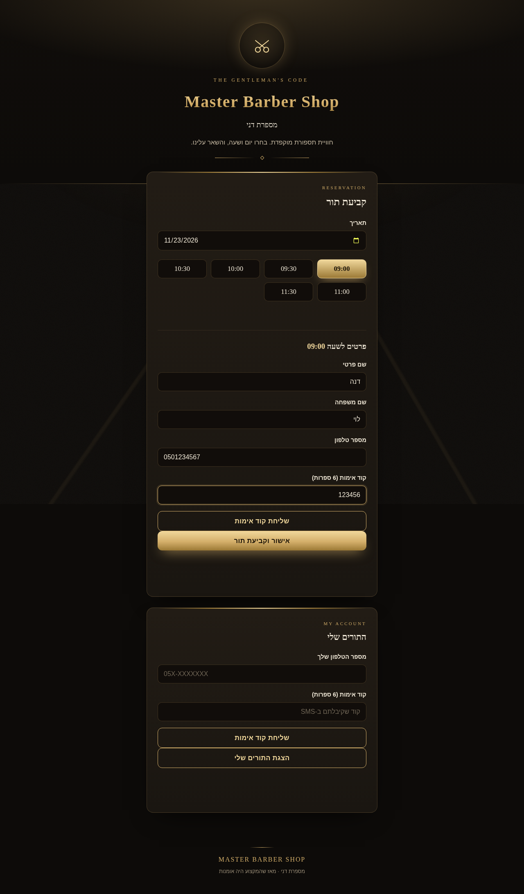
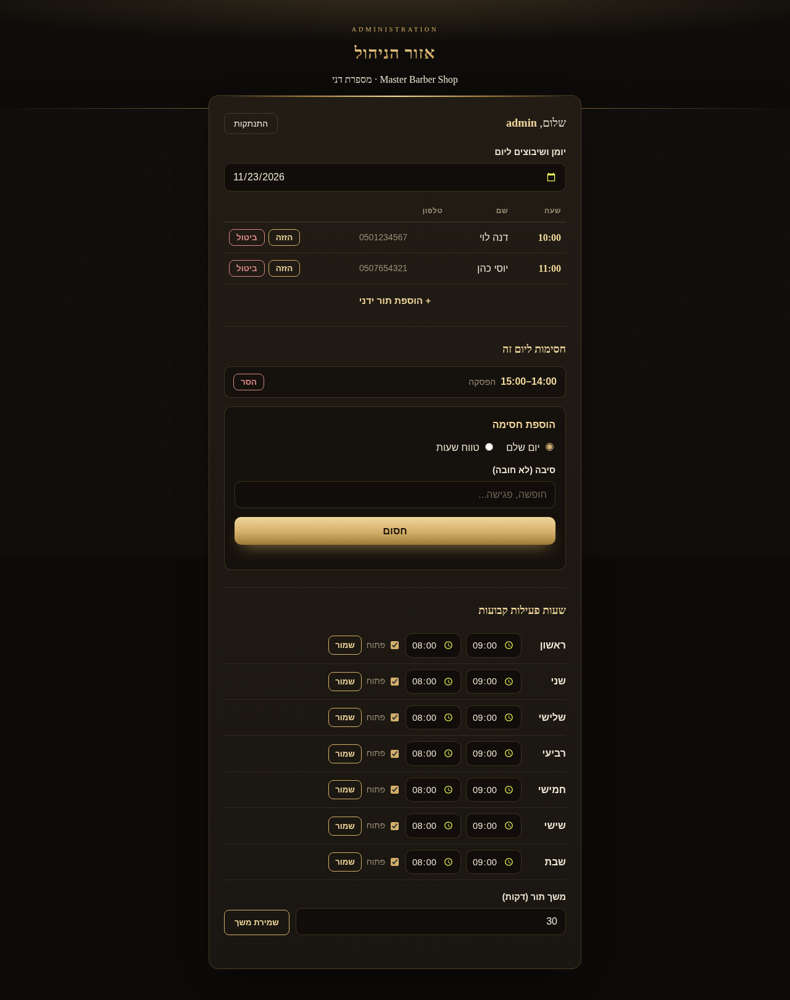

# Master Barber Shop — Appointment Management System

A portfolio-oriented full-stack appointment booking system for a barbershop. A Hebrew right-to-left PWA frontend communicates with a Java / Spring Boot REST API backed by Microsoft SQL Server.

> **Status:** Local/demo MVP; not independently verified end-to-end with SQL Server. Real SMS delivery and production hardening are not included.

## Features

- Customer: view available appointment slots; request a six-digit verification code; book, view and cancel appointments; read notifications.
- Barber/admin: login, daily appointment calendar, create/reschedule/cancel bookings, add blocked hours, and edit working hours/slot duration.
- Data integrity: slot availability calculation, cancellation cutoff, a SQL Server filtered unique index against duplicate active appointment start times.
- Security: per-phone verification for customer changes, BCrypt hashes for admin passwords and codes, same-site admin session and CSRF protection.
- PWA manifest and service worker (application shell only; API stays online).

## Stack

**Backend:** Java 17, Spring Boot 3.5.16, Spring MVC, Spring JDBC, SQL Server, BCrypt.
**Frontend:** HTML, CSS, vanilla JavaScript; Hebrew RTL, mobile-friendly layout, PWA.
**Testing:** JUnit 5 and Mockito, GitHub Actions CI.

## Local setup (Windows / PowerShell)

Prerequisites: JDK 17+, Maven 3.9+, SQL Server and SQL Server Management Studio (SSMS).

1. Open `schema.sql` in SSMS and run it against your local server (it creates the `barbershop` database). **If upgrading from the original project, rerun `schema.sql` to upgrade OTP columns.**
2. Create a least-privilege SQL Server login and database user using `db-user.sql` as a guide; do not save its password in source control. For a local-only setup you may use an existing SQL login you control, with `DB_USER` adjusted.
3. In PowerShell set your local environment variables (supply your *own* values):

   ```powershell
   $env:DB_URL = 'jdbc:sqlserver://localhost:1433;databaseName=barbershop;encrypt=true;trustServerCertificate=true'
   $env:DB_USER = 'barber_app'
   $env:DB_PASSWORD = Read-Host 'SQL Server password'
   $env:ADMIN_USERNAME = 'admin'
   $secureAdmin = Read-Host 'Choose admin password (12+ chars)' -AsSecureString
   $env:ADMIN_PASSWORD = [System.Net.NetworkCredential]::new('', $secureAdmin).Password
   $env:DEMO_MODE = 'true'
   $env:JAVA_TOOL_OPTIONS = '-Duser.timezone=Asia/Jerusalem'
   mvn clean test
   mvn spring-boot:run
   ```

4. Open [Customer UI](http://localhost:8080) or [Admin UI](http://localhost:8080/admin.html). The admin password is the one you configured in `ADMIN_PASSWORD`, **not a hard-coded default**. The application provisions/rotates the admin account at startup.
5. For **demo mode only**, after clicking **Send verification code**, read the six-digit code from the server console. Enter it in the website to complete booking/viewing/cancellation. No text message is actually delivered.

## UI preview (mocked API data, not evidence of a live database)





The screenshots were captured from the real HTML and JavaScript screens, with synthetic example responses from a mocked API. They do not imply successful SQL Server integration testing.

## Tests and CI

```bash
mvn clean verify
```

Unit tests cover OTP verification, authorization gates for appointments and notifications, available slots, and admin CSRF enforcement. GitHub Actions runs the test/package workflow on pushes and PRs. **Integration tests against live SQL Server and real backend/browser E2E tests are still pending.** A browser-level UI smoke check with mocked API responses is available as `scripts/browser_mock_smoke.py` (requires Playwright Python and Chromium).

## Repository tour

- `src/main/java/com/barbershop/boundary` — REST controllers / admin CSRF filter
- `src/main/java/com/barbershop/control` — booking, verification, scheduling, settings
- `src/main/java/com/barbershop/dao` — JDBC repositories
- `src/main/resources/static` — customer and admin UI, PWA
- `src/test` — unit tests
- `schema.sql` — SQL Server schema and compatible OTP migration
- [`docs/ARCHITECTURE.md`](docs/ARCHITECTURE.md) — architecture and main workflows
- [`docs/SECURITY.md`](docs/SECURITY.md) — security constraints and production gaps

## Portfolio summary

**Full-Stack Barber Shop Booking System** — Designed and implemented a Java Spring Boot and SQL Server appointment management system with a responsive Hebrew RTL web interface, customer verification, scheduling rules, admin workflows, and automated unit tests.

## Hebrew / תקציר בעברית

מערכת לניהול תורים למספרה: הזמנת תורים, קוד אימות ללקוח, צפייה וביטול, יומן מנהל, שעות פעילות וחסימות. הפרויקט מיועד להדגמה ולתיק עבודות; שליחת SMS אמיתית ואימות אינטגרציה מלא עדיין אינם כלולים.

**Dependency maintenance:** Spring Boot 3.5.16 is a compatibility-focused upgrade from the uploaded 3.2.5, but the 3.5 community maintenance period has ended; migrate to a current supported 4.x release after verifying compatibility and tests.
